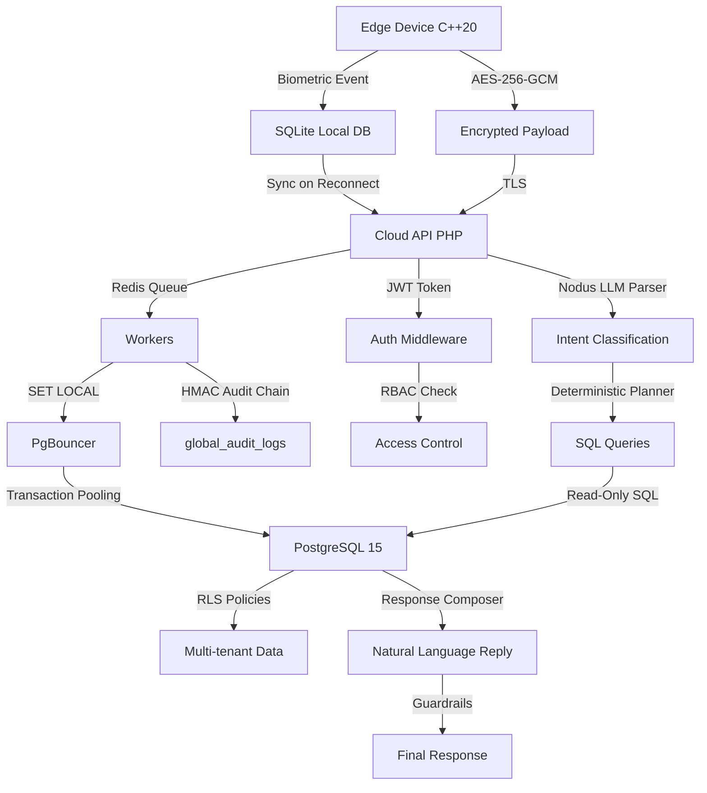

# NEXO Architecture

## Data Flow

1. **Edge Ingest**: C++20 node captures biometric event, encrypts with AES-256-GCM, persists to SQLite with outbox pattern
2. **Cloud Sync**: On reconnect, sync worker uploads encrypted payload to PHP API via TLS
3. **Queue Processing**: Redis queue receives event, worker processes with idempotent fingerprint
4. **Database Operations**: Worker uses SET LOCAL for RLS context through PgBouncer transaction pooling
5. **Authentication**: JWT + RBAC middleware validates access, sets role and school context
6. **Nodus Pipeline**: Natural language query → LLM parser → deterministic planner → RBAC → read-only SQL → composer → guardrails → response
7. **Audit Trail**: All security events logged with HMAC chain for tamper evidence

## Key Patterns

- **Offline-First**: Edge works without connectivity, syncs when available
- **Multi-Tenant Isolation**: PostgreSQL RLS with SET LOCAL prevents cross-tenant leaks
- **Security by Design**: AES-256-GCM encryption, HMAC audit chain, TLS, anti-replay nonces
- **LLM with Guardrails**: Parser only classifies, deterministic layers execute, system degrades without model
